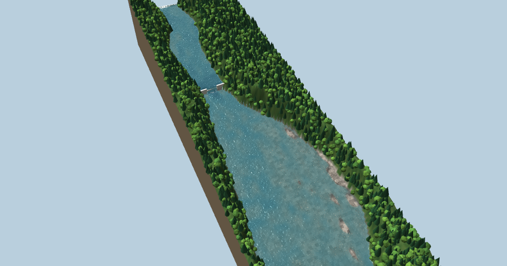

# 連続堰堤 河床変動シミュレータ（sabo-dam-2d）

連続した砂防堰堤（低ダム群・高ダム）の効果を、平面2次元の河床変動計算で調べるシミュレータです。
ブラウザで動く版と、Python（Jupyter Notebook）版があります。

**ブラウザで使う：** https://kisakaki.github.io/sabo-dam-2d/



## できること

- 平面2次元の浅水流と、混合粒径の掃流砂による河床変動の計算
- 網状流路・砂州・アーマー化（交換層モデル）
- 側岸侵食：段丘の側岸の侵食、水中・陸上の安息角、水際の乾いた側岸の侵食、巨礫による流路の固定、長谷川の崩落モデル
- 湾曲部の2次流：流砂の向きの偏りと運動量の分散項（長田ら 1996）
- 流砂は平衡流砂量（芦田・道上）、侵食・堆積速度式（高橋・里深 1999）、土石流（高橋 2007、Kanako 2D と同じ形）から選ぶ
- 土石流の一波（基底流量＋三角形の波、土砂濃度、流入点より上流の勾配）を上流端から流せる
- 透過型堰堤：スリット（1 本・複数）、鋼製格子型、鋼製スリット型。開口の損失と礫の通過、巨礫による閉塞
- 支川の合流（勾配・流量・土砂・合流角を別に設定）。急な支川は合流点に沖積錐を作る
- 伏流（河床の間隙の水、Kozeny–Carman 式の透水係数）
- 勾配の折れ点を何段でも入れられる
- DEM（ASCII grid・XYZ・GeoTIFF・基盤地図情報 XML）から流域界・谷筋・谷頭を求め、流域と水の供給点を地図で選ぶ。供給点ごとにハイドロを設定
- 雨（一様なハイエトグラフか格子の雨）から、損失（流出係数・f1/Rsa・浸透能）と合理式・貯留関数法で谷へ水を集める。格子に直接降らせることもできる
- 斜面崩壊（表層：無限長斜面、深層：Hovland の 3 次元簡便法）。地下水で安全率を求めて崩し、流動化（土石流化）か土塊の移動・堆積
- 天然ダム：越流侵食・進行性崩壊（堤体の透水性で決まる）・すべり破壊。土石流の発生形態を渓床侵食型・崩壊型・天然ダム決壊型から選ぶ
- 堰堤の位置・堤高・水通し幅を自由に設定。向き・中心・天端標高・堤長も指定できる
- 地形は 4 通り：数値で指定（川幅の変化・湾曲・狭窄・澪筋・支渓の扇状地）、横断・縦断の測量値、格子 CSV、DEM から流域を選ぶ
- モデル渓流 2 つ（床固工群の渓流、狭窄部と広い堆砂域。写真の河道を参考にした架空の地形）
- 平面図・縦断図・横断図・鳥瞰図、流量と流砂量の時間変化、堰堤ごとの堆砂量
- 計算後の河床から続けて計算。河床は堰堤の諸元ごと CSV に保存できる
- 時間ごとの結果（河床高・河床変動量・水深・流速・表層平均粒径）を、指定した間隔で CSV に書き出せる

## ファイル

| 場所 | 中身 |
| --- | --- |
| `index.html` | ブラウザ版の本体（1 ファイルで動く。オフラインでも可） |
| `src/` | ブラウザ版の部品（計算 `sabo2d-solver.js`、画面 `ui.js`・`page.html`、測量値の変換 `survey.js`、DEM の解析 `dem.js`、雨の流出 `hydro.js`、DEM の画面 `demui.js`） |
| `python/sabo2d.py` | Python 版（コマンドラインでも、`import` しても使える） |
| `python/sabo2d.ipynb` | Jupyter Notebook 版（`sabo2d.py` と同じ計算をセルに分けたもの） |
| `python/sabo2d_dem.py` | DEM の読み込み・流域の解析・雨の流出（Python 版） |
| `tools/xs2grid.py` | 横断・縦断の測量値を格子 CSV に変換するプログラム |
| `tools/test_*.csv` | テスト地形の CSV（横断・縦断・格子） |
| `docs/` | 計算方法と地形 CSV の解説 |
| `test/` | 計算の検証（静水・等流・収支） |

## ブラウザ版の使い方

1. `index.html` を開く（または上の URL）。
2. 左の「河道地形」でモデル渓流を選ぶか、地形のファイルを読み込む。
3. 「堰堤の諸元」に堰堤を入れる。
4. 「適用して最初から」→「▶ 計算開始」。
5. 時間ごとの結果は、下の「時間ごとの結果を書き出す」で間隔を決めて保存する（縦長の CSV 1 つ、または時刻ごとの CSV をまとめた zip）。

DEM から流域を選ぶとき：「地形の作り方」を「DEM から流域を選ぶ」にして DEM を読み込む（「例の DEM」でも試せる）→ 右の「DEM と流域」の地図で流域をクリック（「出口を指定」で小流域）→「供給点を選ぶ」で谷頭をクリックし、表でハイドロを設定 → 必要なら「土石流の発生形態・雨・斜面崩壊（DEM）」で雨・崩壊・天然ダムを設定 →「適用して最初から」。

地形 CSV の作り方は [docs/csv-guide.md](docs/csv-guide.md) を見てください。

## Python 版の使い方

必要なもの：Python 3.8 以上、NumPy、Matplotlib

```bash
cd python
python sabo2d.py --preset A --minutes 60            # モデル渓流 A を 1 時間の出水で計算
python sabo2d.py --xs ../tools/test_cross_sections.csv --long ../tools/test_longitudinal.csv --dams "150:3:0,300:3:0"
python sabo2d.py --preset B --noneq --bank-h 2 --dry-ero 0.5 --boulders 30   # 非平衡の流砂＋側岸侵食＋巨礫
python sabo2d.py --preset A --bank-h 2 --collapse hasegawa --secondary --secondary-mom   # 長田ら（1996）の崩落モデルと2次流
python sabo2d.py --preset A --debris --debris-peak 60 --slope-table "0:20,300:60" --dams "400:6:0:grid:0.8"   # 土石流の一波、勾配の折れ点、鋼製格子型
python sabo2d.py --preset A --tribs "250:L:6:8:0.3:1:0:60" --gw   # 支川（合流角 60°）と伏流
python sabo2d.py --dem synth --debris --rain "0:50,10:80,20:0" --slide "600,800,30,2,shallow,time,30,fluid"   # 例の DEM：谷頭から土石流、雨、斜面崩壊
python sabo2d.py --dem dem.tif --dem-outlet "X,Y" --ldam "X2,Y2,20" --ldam-k 0.01   # DEM の小流域に天然ダム（座標は DEM の座標）
python sabo2d.py --params sabo2d_params.json   # ブラウザ版の「計算条件を JSON で保存」で保存した条件をそのまま計算
python sabo2d.py --preset A --snap-every 5          # 5 分ごとの結果を result/snapshots_long.csv と result/snapshots/ に書く
python sabo2d.py --help
```

Jupyter では `python/sabo2d.ipynb` を開いて上から実行します。

同じ条件なら、Python 版とブラウザ版は同じ地形・同じ計算になります。差は丸め誤差（数千ステップで 10⁻¹⁰ m 程度）だけですが、急勾配の網状流路を長時間計算すると、個々のセルではこの差が広がることがあります（モデル渓流 A の 3 時間の計算で、セルごとに最大 0.1 m 程度、堆砂量の合計で 1 % 未満）。

## 計算方法の要点

- 流れ：平面2次元浅水流方程式、有限体積法（HLL＋静水圧再構築）、Manning 則
- 流砂：芦田・道上式（1972）による粒径別の掃流砂量
- 限界掃流力：芦田・高橋・水山（1978）、岩垣（1956）、一定値から選ぶ
- 粒度：交換層（平野 1971）＋多層の堆積層
- 非平衡の流砂：高橋・里深（1999）、高橋ら（1998）の侵食・堆積速度式（選択）
- 側岸侵食：高橋・里深・奥村（1996）の水中安息角と巨礫による流路の固定、長田ら（1996）の長谷川型崩落モデルと2次流、Delft3D の dry-cell erosion、XBeach の wetslp／dryslp の考え方
- 文献の式の適用条件は [docs/model.md](docs/model.md) の表にまとめています
- 土石流：高橋（2007）の侵食・堆積速度式と抵抗則（Kanako 2D と同じ形）
- 透過型堰堤：開口の損失（Idelchik）、閉塞（土石流対策技術指針（案）2000 など）
- 伏流：Kozeny–Carman 式、Dupuit 近似
- 浮遊砂・流木は扱わない

詳しくは [docs/model.md](docs/model.md) にあります。

## 作り直し（開発者向け）

```bash
npm install          # three.js r128 を入れる
python3 build.py     # src/ から index.html と dist/ を作る
npm test             # 検証の計算
cd python && python make_notebook.py   # sabo2d.py からノートブックを作り直す
```

## ライセンス

MIT License（[LICENSE](LICENSE)）。研究・教育での利用を想定した参考用のツールです。結果を設計や判断に使うときは、ご自身で妥当性を確かめてください。
