# 取扱説明書　河床変動シミュレータ

ブラウザで動く平面 2 次元の河床変動・土石流シミュレータの使い方を、画面と計算例で説明します。

- **シミュレータ（ブラウザで開くだけ）**：<https://kisakaki.github.io/sabo-dam-2d/>
- **ソース・Python 版**：<https://github.com/kisakaki/sabo-dam-2d>
- **モデルの式と参考文献**：[docs/model.md](../model.md)
- **CSV の形式**：[docs/csv-guide.md](../csv-guide.md)

このツールは、実際の出水を再現するためのものではありません。既存の物理モデルで計算すると、どのような現象が起きるのかを確かめるためのものです。たとえば、堰堤の位置を変えたり、基数を増やしたり減らしたりしたときに、河床変動がどう変わるかを比べられます。計算の結果は、何かを保証するものではありません。

インストールはいりません。Chrome・Edge・Safari・Firefox の新しい版で動きます。計算はすべて手元のブラウザの中で行い、データはどこにも送りません。

---

## 目次

1. [できること](#1-できること)
2. [画面の見方と基本の流れ](#2-画面の見方と基本の流れ)
3. [地形を作る（数値・測量値・CSV）](#3-地形を作る数値測量値csv)
4. [水と土砂の供給（ハイドロ）](#4-水と土砂の供給ハイドロ)
5. [砂防堰堤（不透過・透過型）](#5-砂防堰堤不透過透過型)
6. [粒径と河床材料（場所ごとの粒度分布）](#6-粒径と河床材料場所ごとの粒度分布)
7. [流砂モデル・側岸・伏流](#7-流砂モデル側岸伏流)
8. [計算条件](#8-計算条件)
9. [結果の見方](#9-結果の見方)
10. [DEM から流域を選んで計算する](#10-dem-から流域を選んで計算する)
11. [雨（一様・XRAIN）](#11-雨一様xrain)
12. [斜面崩壊（表層・深層）](#12-斜面崩壊表層深層)
13. [天然ダム（河道閉塞）](#13-天然ダム河道閉塞)
14. [DEM の流域の砂防堰堤・河床材料](#14-dem-の流域の砂防堰堤河床材料)
15. [Python 版](#15-python-版)
16. [扱わないこと・注意](#16-扱わないこと注意)

---

## 1. できること

| 分野 | 内容 |
|---|---|
| 流れ | 平面 2 次元の浅水流（HLL 系の有限体積法、2 次精度）。射流・跳水・乾湿の境界も扱う |
| 流砂 | 混合粒径の掃流砂（芦田・道上式、修正 Egiazaroff 式の遮蔽効果）、非平衡の侵食・堆積速度式（高橋・里深）、土石流（高橋の式） |
| 河床材料 | 粒径階 12 まで、河床材料 12 種類まで。場所ごと（区間・左岸からの距離・平面図の多角形・DEM の多角形）に変えられる |
| 構造物 | 不透過型・透過型（スリット、複数スリット、鋼製格子型、鋼製スリット型）の砂防堰堤。閉塞も扱う |
| 地形 | 数値で作る河道（川幅・勾配の変化、湾曲、支川、渓流の作り込み）、測量の横断・縦断、格子 CSV、DEM（基盤地図情報・GeoTIFF・ASCII） |
| DEM の流域 | 流域界・谷筋・谷頭の自動抽出、雨（一様・XRAIN）、斜面崩壊（表層・深層）、天然ダム（越流・進行性崩壊・すべり）、砂防堰堤 |
| 結果 | 鳥瞰（3D）、平面図、横断、縦断（谷に沿った線も）、流量・流砂量の時系列、堰堤ごとの堆砂量、CSV の書き出し |

---

## 2. 画面の見方と基本の流れ

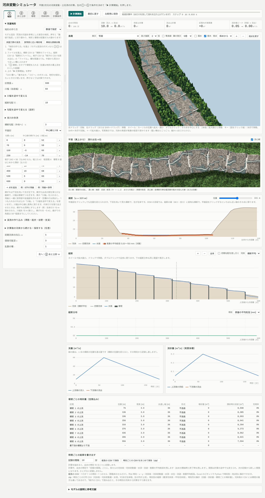

画面の左が**条件の欄**、右が**結果の図**です。左の欄の幅は、境目をドラッグして広げられます。

**基本の流れ**

1. 左の欄の上にある **①〜⑤ のタブ** を順に開いて、条件を決める。

   

   - **① 地形**：地形の作り方（数値・測量値・CSV・DEM）
   - **② 水と土砂**：ハイドロ。DEM のときは供給点・雨・斜面崩壊・天然ダム
   - **③ 堰堤**：堰堤の位置・高さ・形式
   - **④ 河床材料**：粒径と、場所ごとの河床材料
   - **⑤ 計算条件**：流砂モデル・側岸侵食・格子幅など

   各タブの下の「次へ」で、次のタブに進めます。
2. 上の **「▶ 計算開始」** を押す。条件を変えていれば、地形と格子を作り直してから最初から計算します。もう一度押すと一時停止します。
3. 右の図で結果を見る。計算中でも見られます。
4. 必要なら CSV や画像を保存する（[9 章](#9-結果の見方)）。

条件を変えると、「条件が変わりました」と黄色で知らせます。このとき「▶ 計算開始」を押すと、新しい条件で最初から計算します。「最初に戻す」を押すと、計算せずに新しい条件の地形だけを作ります。

---

## 3. 地形を作る（数値・測量値・CSV）

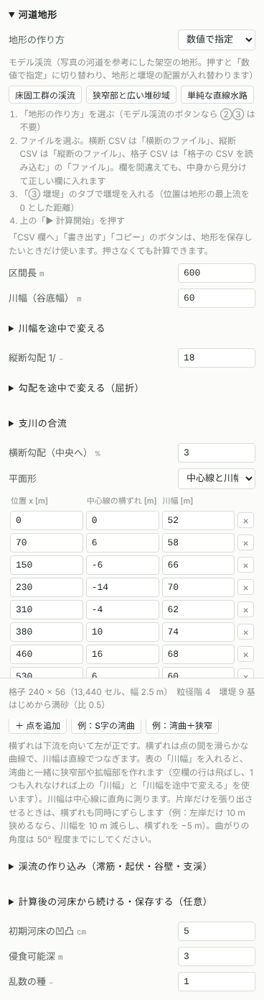

「① 地形」タブの **地形の作り方** で選びます。

| 作り方 | 使う場面 |
|---|---|
| 数値で指定 | 区間長・川幅・勾配などの数値から、理想化した渓流を作る。まず試すとき |
| 横断・縦断の測量値 | 測量の横断（x, s, z）と縦断（x, z）の CSV から作る |
| 格子の CSV を読み込む | 格子状の標高（行列か x, y, z）を読む。計算後の河床を保存したものも読める |
| DEM から流域を選ぶ | DEM を読み、流域を選んで切り出す（[10 章](#10-dem-から流域を選んで計算する)） |

**数値で指定**のときに使える追加の設定：

- **川幅を途中で変える**：位置と川幅の表。狭窄部や拡幅部を作る。
- **勾配を途中で変える（屈折）**：位置と勾配 1/n の表。急勾配から緩勾配への屈折点は土砂がたまりやすい。
- **支川の合流**：位置・左右・幅・勾配・流量比・土砂量比・遅れ・合流角度。
- **渓流の作り込み**：澪筋（初期の低水路の蛇行）、砂州・淵の起伏、谷壁、支渓。
- **湾曲**：正弦の蛇行か、表で中心線を与える。

---

## 4. 水と土砂の供給（ハイドロ）

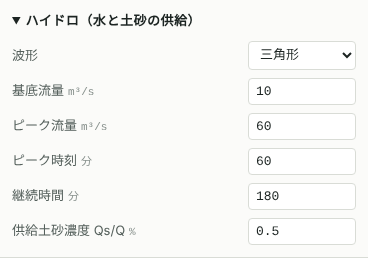

上流端から流す水と土砂です。**波形**を選びます。

| 波形 | 内容 |
|---|---|
| 三角形 | 基底流量からピーク流量まで直線で上がり、下がる |
| 一定 | 一定の流量 |
| 表で入力 | 時刻・流量・供給土砂量の表 |
| 土石流の一波 | 基底流量（清水）に、三角形の土石流の波（ピークは混合物の流量、土砂濃度 C）を重ねる。流砂モデルは自動で「土石流」になる |

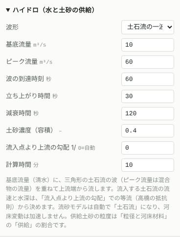

供給土砂の粒度は、[6 章](#6-粒径と河床材料場所ごとの粒度分布)の表の「供給」の列です。

**計算例（土石流の一波）**：既定の河道に土石流の一波を流した 10 分後。堰堤の上流に堆積していく様子が分かります。

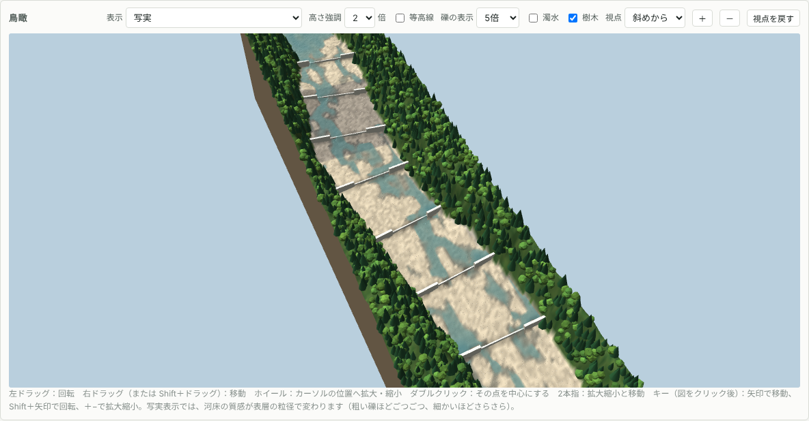
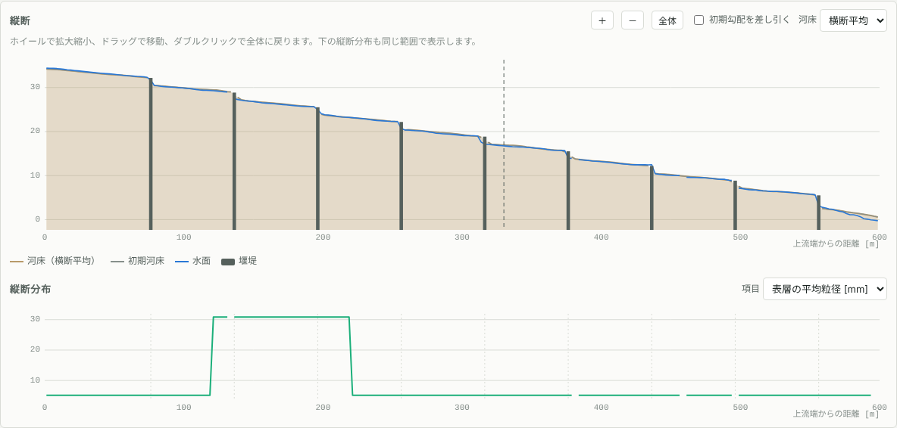
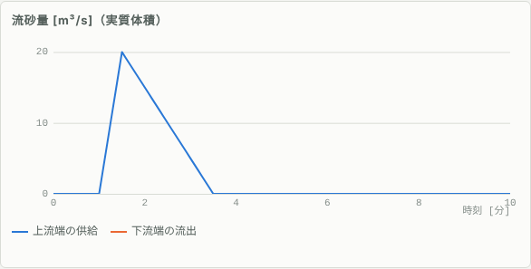

---

## 5. 砂防堰堤（不透過・透過型）

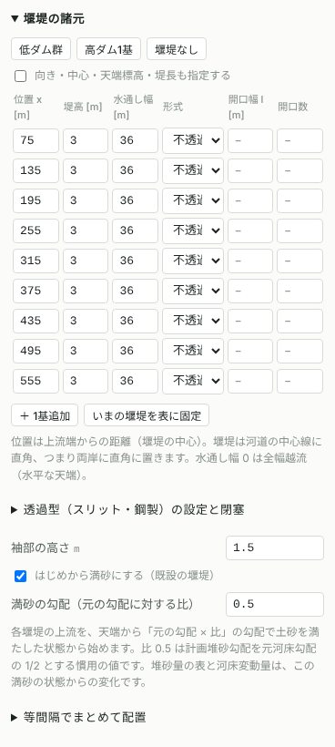

「③ 堰堤」タブの「堰堤の諸元」の表で、位置 x・堤高・水通し幅・形式を決めます。「等間隔でまとめて配置」で低ダム群を一度に置けます。「向き・中心・天端標高・堤長も指定」をオンにすると、堰堤の向き（回転）・中心・天端標高・堤長も指定できます。

| 形式 | 開口 |
|---|---|
| 不透過 | なし |
| スリット | 水通しの中央に 1 本（開口幅 l） |
| 複数スリット | n 本（開口幅 l、柱の幅 wp） |
| 鋼製格子型 | 鋼管の格子（純間隔 l、部材の幅 w） |
| 鋼製スリット型 | 鋼製の縦部材（純間隔 l、部材の幅 w） |

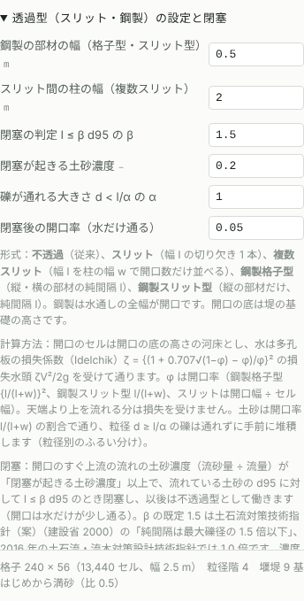

透過型は、開口を多孔板の損失（Idelchik）で水が通り、粒径 d ≥ l/α の礫は通れません。流れの土砂濃度と l ≤ β d95（既定 β = 1.5）で閉塞を判定し、閉塞後は不透過型として働きます。**鋼製の部材の幅**と**スリット間の柱の幅**は別々に指定します。

「はじめから満砂」で、計算の最初から堰堤の上流を埋めておけます（堆砂勾配と元の勾配の比で指定）。

---

## 6. 粒径と河床材料（場所ごとの粒度分布）


**粒度分布の作り方**は 3 通りです。

1. **代表的な河床材料**：砂・砂礫・礫床・渓床の土石流堆積物・一様粒径のひな形から選ぶ。
2. **平均粒径と幅から作る**：平均粒径 dm（算術平均）、分布の幅 σg = √(d84/d16)、粒径階の数（12 まで）を入れて「平均粒径と幅から作る」を押す。対数正規分布を粒径階に分けて表を作ります。
3. **表に直接入れる**：粒径 [mm] と各列の割合 [%]。割合の合計は 100 でなくても比として使います。

表の下に、河床・供給・各材料の dm・d16・d50・d84・d90 と粒径加積曲線が出ます。

### 場所ごとの粒度分布（河床材料 A〜L）

粒径階は共通で、**河床材料**を 12 種類まで持てます。

1. 「＋ 河床材料を追加」で、表に「河床 B」「河床 C」…の列を足す。
2. 各列に割合を入れる（「作る先」で B などを選んで「平均粒径と幅から作る」でもよい）。
3. 材料を置く場所を決める。どこにも入らないところは河床 A です。後の行が優先します。
   - **区間**：「＋ 区間を追加」で、x の始点・終点（上流端からの距離）と、左岸からの距離の範囲（空欄は全幅）。
   - **平面図に範囲を描く**：ボタンを押して平面図で頂点をクリックし、ダブルクリックで確定（Esc でやめる）。先に「▶ 計算開始」か「最初に戻す」で地形を作っておいてください。
   - **DEM の流域**：地図の「河床材料の範囲を描く」で多角形を描く（[14 章](#14-dem-の流域の砂防堰堤河床材料)）。
4. 「▶ 計算開始」を押す。

**計算例**：x = 120〜220 m を粗い材料 B（dm 60 mm）にした場合の表層の平均粒径。

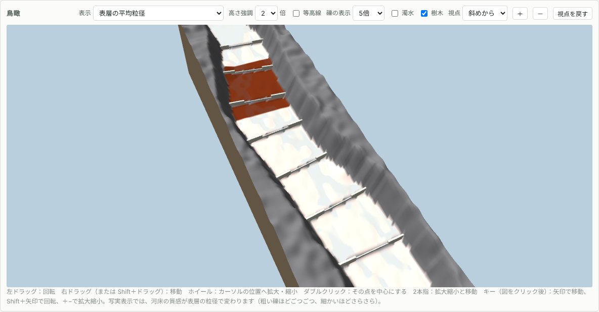
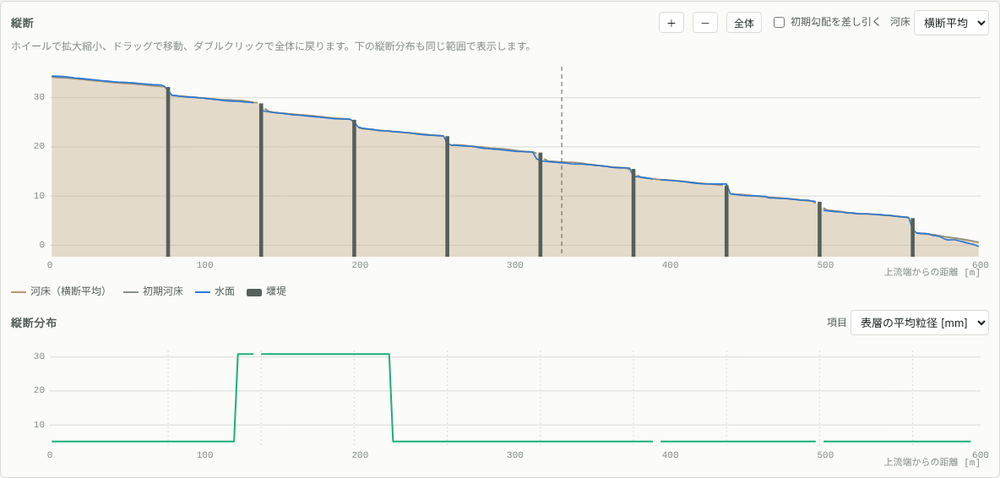

---

## 7. 流砂モデル・側岸・伏流

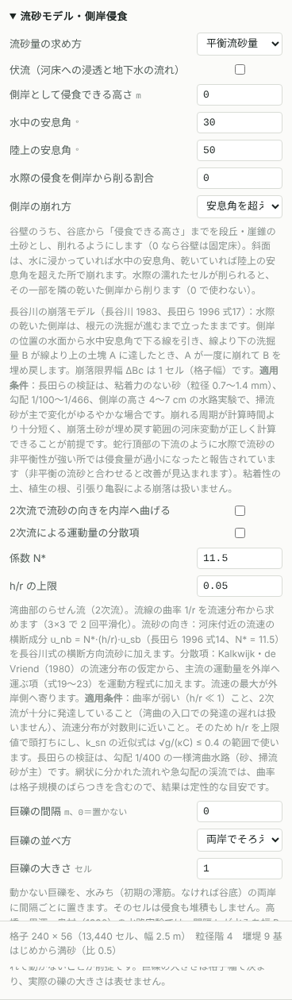

**流砂量の求め方**

| モデル | 式 | 使う場面 |
|---|---|---|
| 平衡流砂量 | 芦田・道上式（粒径別）。限界掃流力は芦田・高橋・水山式・岩垣式・一定値。粒径別は修正 Egiazaroff 式（遮蔽効果）か、全粒径で平均粒径の値 | 掃流砂が主の河道 |
| 侵食・堆積速度式 | 高橋・里深（1999）の非平衡の掃流砂 | 水際や急変部で非平衡が強いとき |
| 土石流 | 高橋の侵食・堆積速度式と抵抗則（石礫型・乱流型） | 土石流 |

**修正 Egiazaroff 式**は、粒径別の限界掃流力を平均粒径との比で変える式で、細かい粒子は大きな粒子の陰に隠れて動きにくく、大きな粒子は突き出して動きやすくなる効果（遮蔽効果）を表します（d/dm < 0.4 は芦田・道上の修正で一定値）。これにより、細粒の選択的な流出や粗粒化（アーマー化）が起きます。

**側岸**：安息角を超えた斜面を崩す（水中・陸上の安息角を分ける）。長谷川の崩落モデルも選べます。水際の乾いた側岸を削る割合、侵食される側岸の高さも指定できます。

**伏流**：河床への浸透と堆積層の中の地下水の流れを計算します（透水係数は Kozeny–Carman 式か指定値）。

**2 次流**：湾曲部のらせん流で流砂の向きを内岸へ曲げる（長田ら 1996）、運動量の分散項（Kalkwijk・de Vriend 1980）。

**巨礫**：岸に動かない巨礫を並べる（高橋・里深・奥村 1996）。

それぞれの式と適用条件は、欄の中の説明と [docs/model.md](../model.md) にあります。

---

## 8. 計算条件


- **格子幅**：細かいほど正確ですが遅くなります。DEM の流域では、セル数が上限（約 6 万）を超えないよう自動で粗くします。
- **河床変動の加速係数**：河床変動を何倍速で進めるか（土石流では使いません）。
- **空間精度**：2 次（推奨）か 1 次。

---

## 9. 結果の見方

既定の条件（低ダム群 9 基、三角形のハイドロ）で 20 分計算した結果です。

### 鳥瞰（3D）

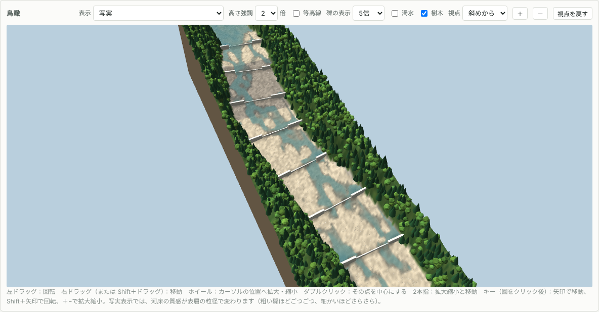

**表示**で色を切り替えます：写実、陰影＋段彩、赤色立体風（尾根が明るく谷が暗い・急なほど赤い）、傾斜、河床位、水深、流速、河床変動量、表層の平均粒径、無次元掃流力、フルード数、流れの土砂濃度、伏流の飽和度など。

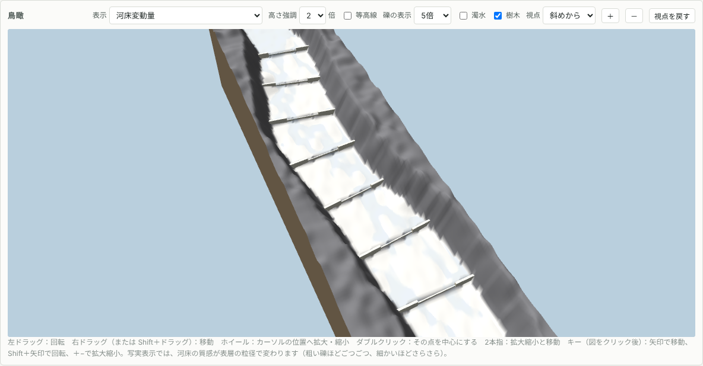
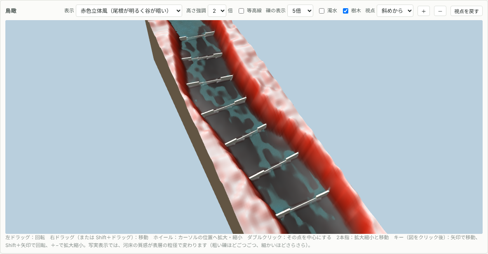

**操作**：左ドラッグで回転、右ドラッグ（Shift＋ドラッグ）で移動、ホイールで拡大・縮小、ダブルクリックでその点を中心に。高さ強調・等高線・礫の表示・濁水・樹木も切り替えられます。

### 平面図

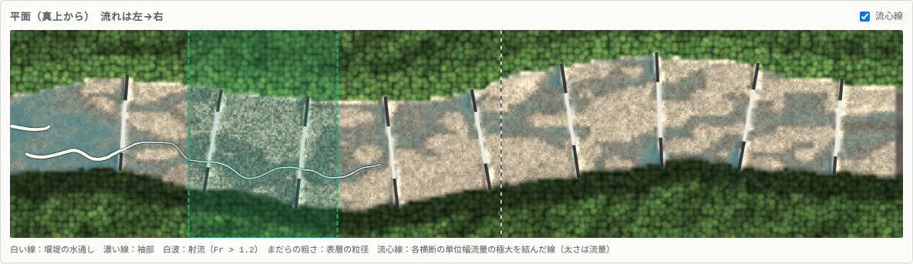

真上から見た図です。白い線は堰堤の水通し、白波は射流（Fr > 1.2）、流心線は単位幅流量の極大を結んだ線です。**平面図をクリックすると、その位置の横断を表示します。**

### 横断・縦断

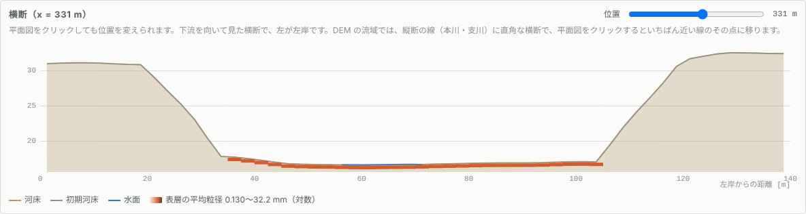

下流を向いて見た横断で、左が左岸です。下の色の帯は表層の平均粒径です。

縦断（[6 章](#6-粒径と河床材料場所ごとの粒度分布)の図）は、河床（横断平均か最深）・初期河床・水面・堰堤を描きます。「初期勾配を差し引く」で変化が見やすくなります。下の「縦断分布」で平均粒径・流砂量・水面幅・変動量を選べます。ホイールで拡大、ドラッグで移動、ダブルクリックで全体に戻ります。

### 時系列と数値のまとめ

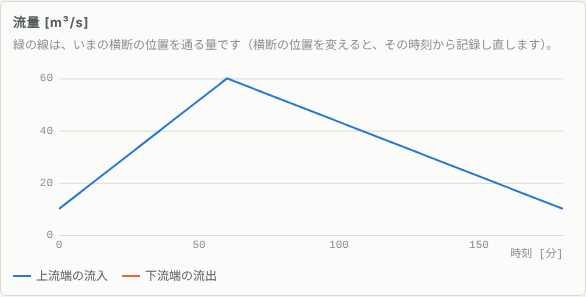
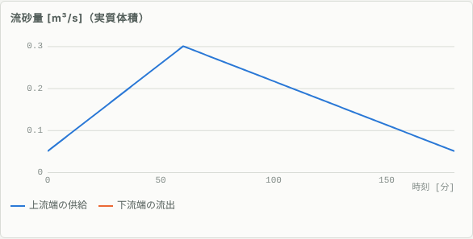


緑の線は、いまの横断の位置を通る流量・流砂量です（横断の位置を変えると、その時刻から記録し直します）。表は堰堤ごとの区間の堆砂量と満砂時の目安です。

### 保存と比較

- **比較用に保存**：いまの結果を残し、次の計算の縦断・流砂量に破線で重ねます。
- **記録の間隔**（分）：時刻ごとの河床・水深などを残します。縦長の CSV や zip（時刻ごとの行列・縦断・集計）で書き出せます。
- **計算後の河床を保存**：格子の CSV として保存し、「格子の CSV を読み込む」でそこから計算を続けられます。

---

## 10. DEM から流域を選んで計算する

ここからは、国土地理院の **基盤地図情報 数値標高モデル 5m メッシュ（DEM5A）** の 2 次メッシュ **553706**（`FG-GML-553706-DEM5A-20251113.zip`）を使って説明します。

### 10.1 データの入手

基盤地図情報ダウンロードサービス（<https://fgd.gsi.go.jp/download/>）で「数値標高モデル」→「5m メッシュ」を選び、範囲を指定してダウンロードします（ZIP）。**ZIP のまま読み込めます**（ZIP の中の ZIP も開きます）。複数のメッシュの ZIP を一度に選ぶと、つないで読みます。

> 出典：国土地理院 基盤地図情報 数値標高モデル。データの利用は国土地理院の利用規約に従ってください。このリポジトリには DEM のファイルを入れていません。

### 10.2 読み込みと地図

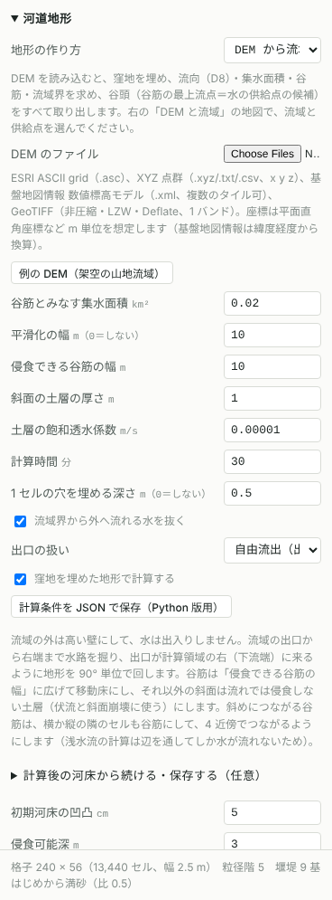

1. 「地形の作り方」で **DEM から流域を選ぶ** を選ぶ。
2. 「DEM のファイル」で ZIP（または XML・GeoTIFF・ASCII・XYZ）を選ぶ。

読み込むときに次を自動で行います。

- **欠測の穴埋め**：DEM の縁につながらない欠測（5m メッシュの測量のない所）を、周りの値で埋めます（553706 では 19,749 セル）。
- **平滑化**：「平滑化の幅」（既定 10 m、0 でしない）で細かな凹凸をならします。
- **谷筋と流域**：窪地を埋め（Priority-Flood）、D8 の流向・集水面積・次数を求め、「谷筋とみなす集水面積」以上を谷筋、上流に谷筋のない谷筋のセルを谷頭とします。

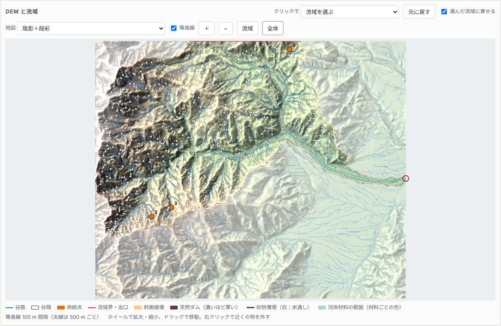

**地図の表示**は、陰影＋段彩・赤色立体風・傾斜・段彩のみと、等高線を選べます。ホイールで拡大・縮小、ドラッグで移動、「流域」「全体」で表示範囲を戻せます。

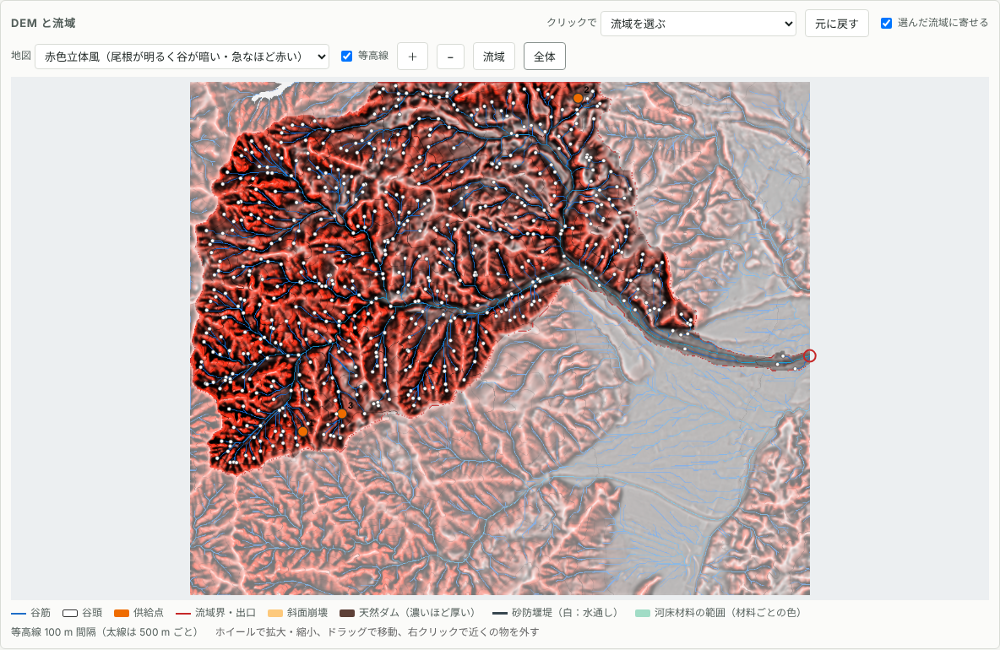
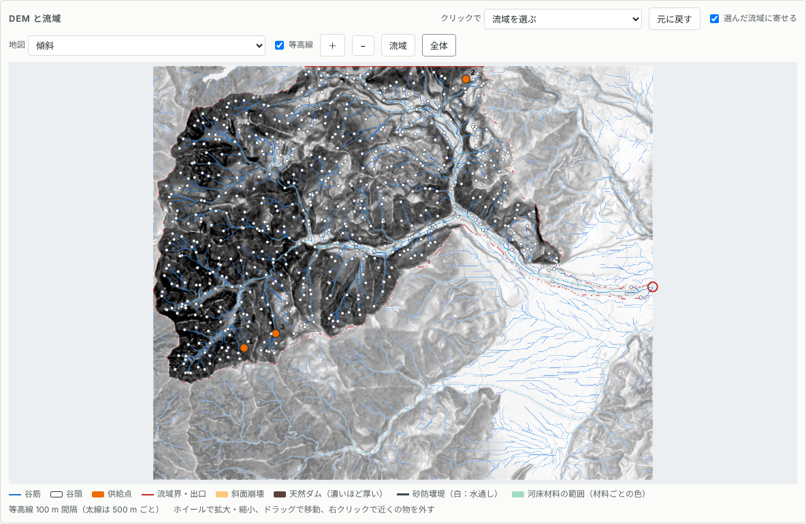

### 10.3 流域と出口を選ぶ

地図の上の **「クリックで」** で操作を選びます。

| 操作 | 内容 |
|---|---|
| 流域を選ぶ | DEM の縁へ出る流域から選ぶ |
| 出口を指定（小流域） | 谷筋のセルをクリックすると、その上流を流域にする |
| 供給点を選ぶ | 谷頭をクリックして水と土砂を流す点にする（もう一度で外す） |
| 崩壊を置く / 天然ダムを置く / 砂防堰堤を置く / 河床材料の範囲を描く | 各章を参照 |
| 消す | クリックした物を外す |

ここでは、出口を指定して 1.64 km² の小流域を選びました（赤い丸が出口、橙の丸が供給点）。

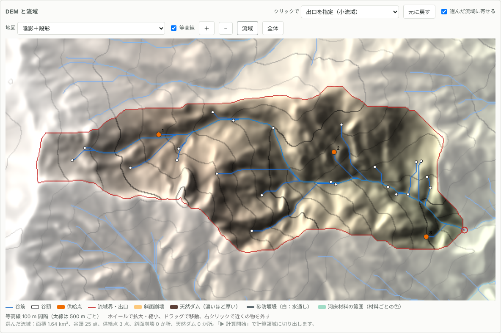

置いた物は **「元に戻す」（Ctrl＋Z）**、**右クリック**、または「消す」で取り消せます。

**出口の扱い**：既定は「自由流出」です。出口の先に緩衝の水路（計算格子 3 セル）をとり、その先で水と土砂を抜いて流出として数えます。「流域界から外へ流れる水を抜く」をオンにすると、流域界（分水界）を越えて外へ流れる水も抜きます。

### 10.4 土石流（渓床侵食型）

「土石流の発生形態・雨・斜面崩壊（DEM）」→「谷頭の供給点とハイドロ」で、供給点ごとの波形を決めます。ここでは 2 点とも **土石流の一波**（ピーク 20 m³/s、濃度 0.3、立ち上がり 60 秒、減衰 300 秒）にしました。

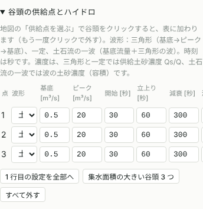

「▶ 計算開始」（または「最初に戻す」）を押すと、流域を切り出して出口が右端に来るよう回し、計算領域を作ります。流域の外は高い壁、谷筋（幅は「侵食できる谷筋の幅」）は侵食できる河床、斜面は侵食しない土層になります。

**計算例（15 分後）**

DEM の流域は広いので、鳥瞰は「高さ強調 1 倍」にし、「－」で少し縮小すると全体が見えます（下の図はこの見え方です）。


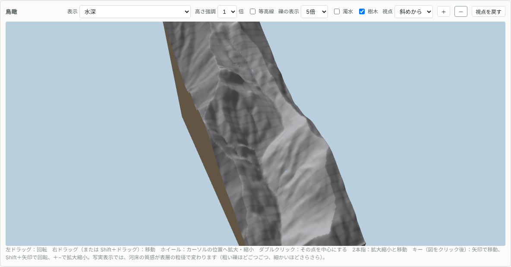


**縦断は谷に沿った線**で描きます。「線」で本川・支川を切り替えられます。横断はその線に直角です。平面図をクリックすると、いちばん近い線のその点の横断になります。

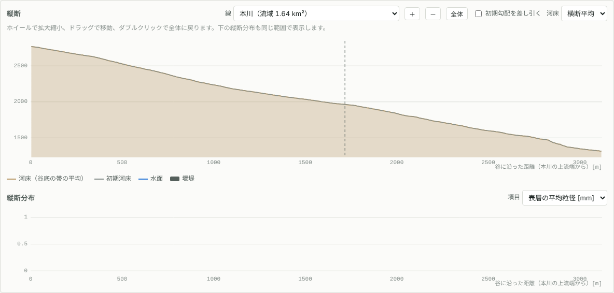
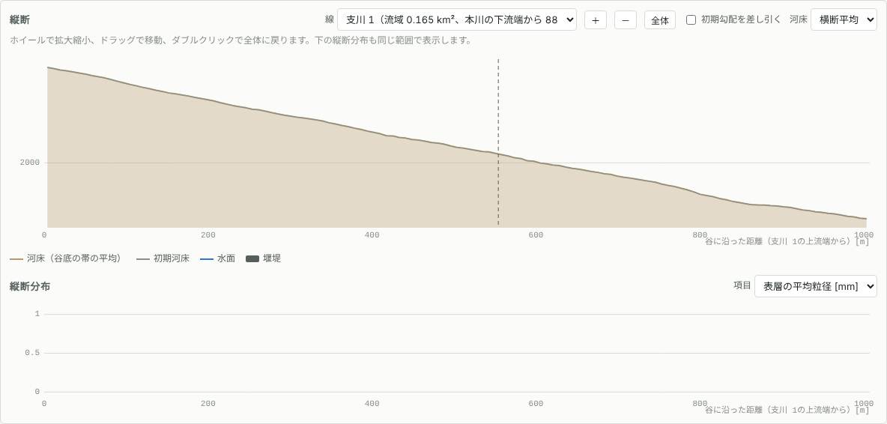
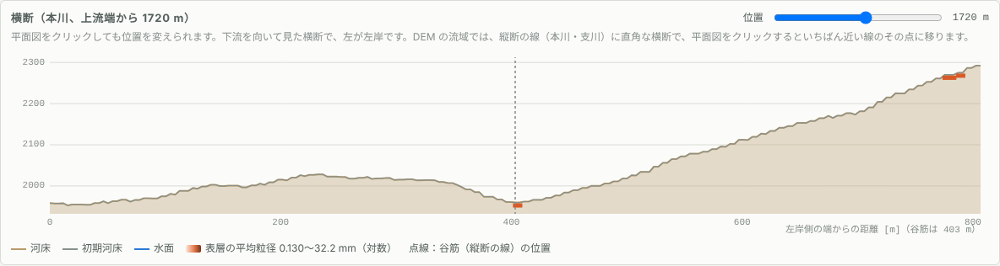

流量の図の青は供給点・雨の合計の流入、橙は出口からの流出（土石流は水と土砂の混合物）、緑は横断の位置を通る量です。

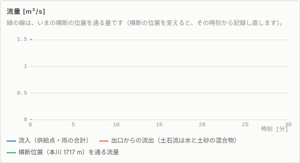
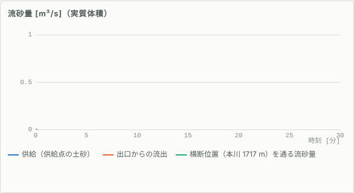

---

## 11. 雨（一様・XRAIN）

「雨（谷へ集まる水）」で **雨を降らせる** をオンにします。

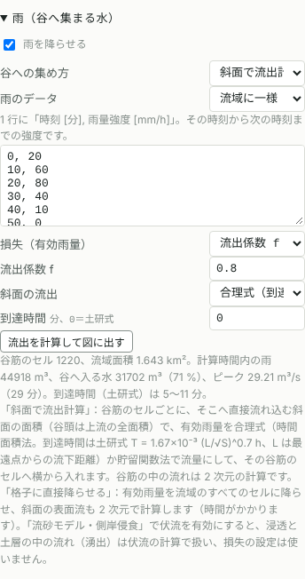

| 項目 | 選び方 |
|---|---|
| 雨のデータ | 流域に一様（ハイエトグラフ：時刻 [分], 強度 [mm/h] の表）／格子の雨（XRAIN などを変換した CSV） |
| 谷への集め方 | 斜面で流出計算して谷筋へ入れる（集中化）／格子に直接降らせる（表面流で計算） |
| 損失 | 流出係数 f（合理式）、一次流出率 f1・飽和雨量 Rsa（貯留関数法）、飽和透水係数 ks と土層（浸透） |
| 斜面の流出 | 合理式（到達時間は土研式か指定）／貯留関数法 s = K q^P |

「流出を計算して図に出す」で、谷へ入る流量の時系列を確かめられます。

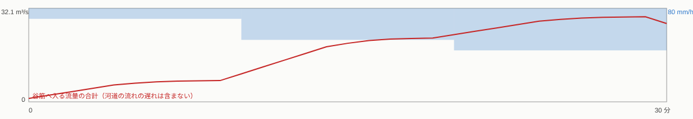

### 疑似 XRAIN

本物の XRAIN（X バンド MP レーダ雨量計、250 m メッシュ・1 分）の代わりに、形をまねた**架空の雨**を作るスクリプト `tools/make_pseudo_xrain.py` を用意しました。背景の雨に、北東へ動く対流セル（最大 80 mm/h）を重ねます。

```
python tools/make_pseudo_xrain.py                      # 553706 の範囲、120 分、5 分おき
python tools/make_pseudo_xrain.py --minutes 180 --step 1 --peak 100 --out rain.csv
```

できたファイル（`examples/pseudo_xrain_553706.csv`）は、1 行に「時刻 [分], 経度, 緯度, 雨量強度 [mm/h]」です。本物の XRAIN も、この形に変換すれば読めます。「雨のデータ」を **格子の雨** にして読み込みます。

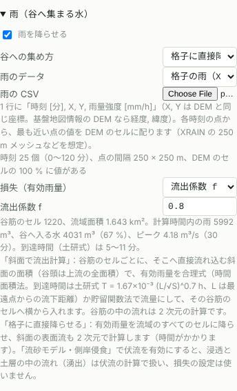
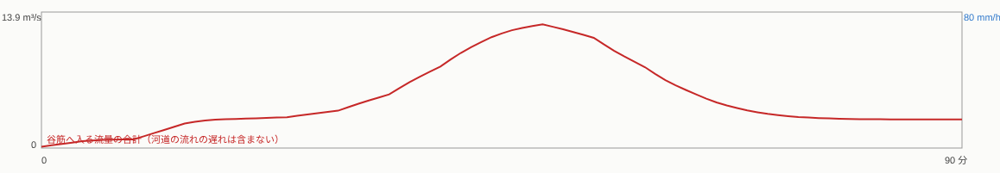

**計算例**：疑似 XRAIN を「格子に直接降らせる」で 60 分計算した結果です（対流セルが流域を通る 50 分ごろに流量が増えます）。

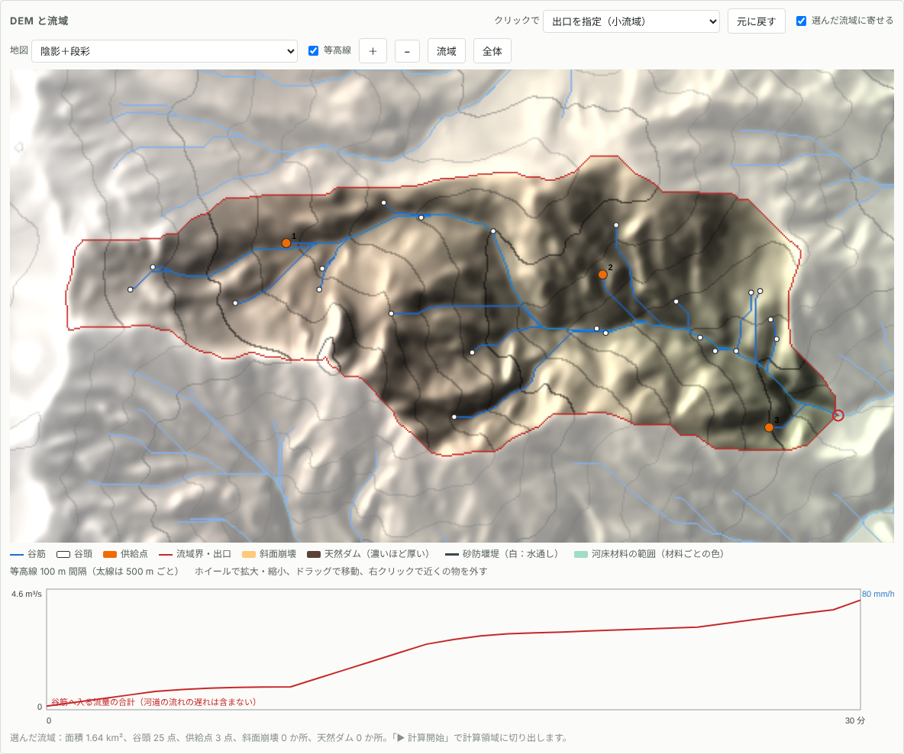
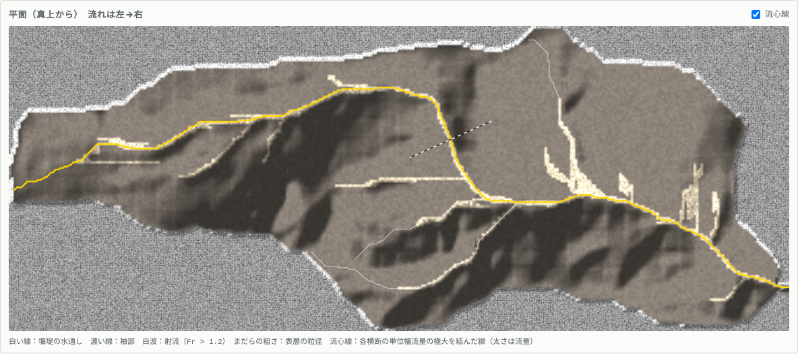
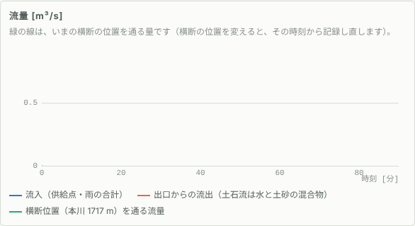
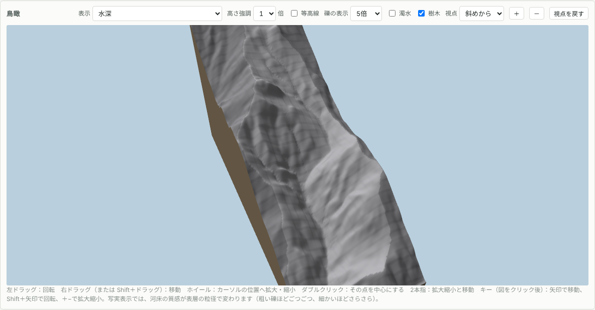

---

## 12. 斜面崩壊（表層・深層）

「土石流の発生形態」を **崩壊型** にし、地図の「崩壊を置く」で置きます。**崩壊の形**は、円（中心をクリック）か **多角形**（頂点をクリック、ダブルクリックか「多角形を閉じる」で確定）です。

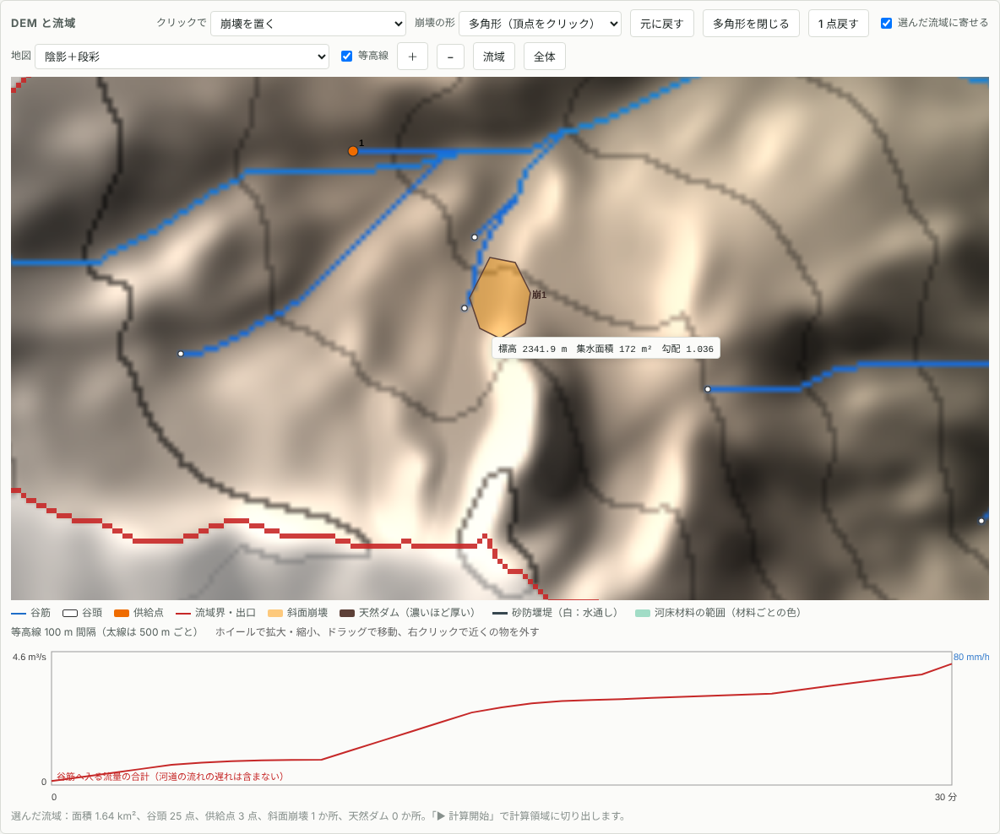
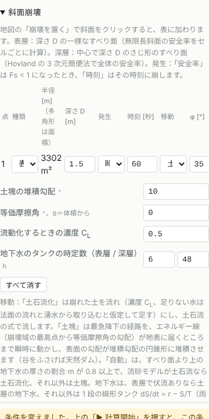

| 項目 | 内容 |
|---|---|
| 種類 | 表層（無限長斜面、一様な深さ D）／深層（Hovland の 3 次元簡便法、さじ形のすべり面） |
| 崩れる条件 | 安全率（雨と地下水位から計算した Fs < 1）／時刻（指定の時刻に崩す） |
| 動き方 | 自動／土石流化（水と混ざって流れる）／土塊（エネルギー線で止まるまで一体で動き、円錐状に堆積） |
| φ・c・初期の飽和度 | 土の内部摩擦角・粘着力・地下水 |

**計算例 1（表層・土石流化）**：60 秒に崩れ、土石流として谷を下る。

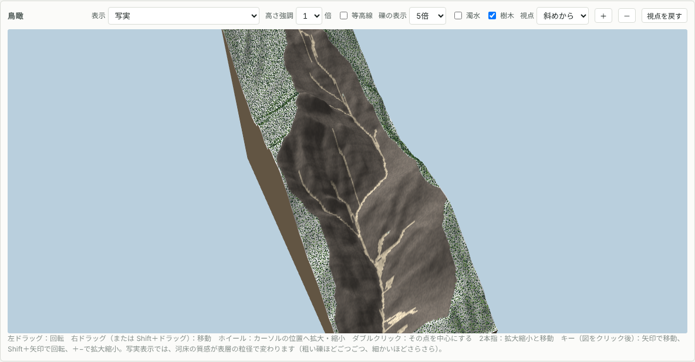
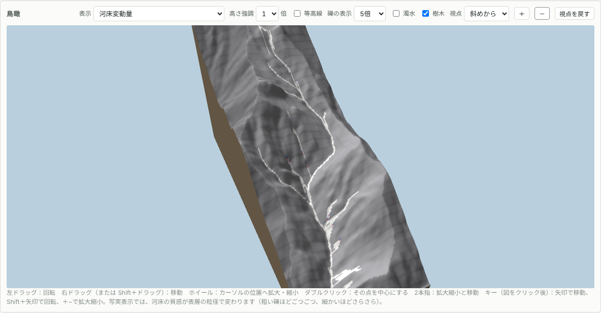
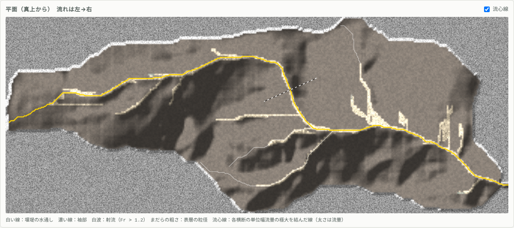

**計算例 2（深層・土塊）**：同じ範囲を深さ 8 m の深層崩壊・土塊にした場合。土塊は谷へ移り、谷をふさぐと天然ダムとして扱います。


---

## 13. 天然ダム（河道閉塞）

「土石流の発生形態」を **天然ダム決壊型** にし、地図の「天然ダムを置く」で谷筋をクリックします。「例：本川に天然ダムと上流の供給点を置く」で、谷の深い所に例のダムと上流の供給点（40 m³/s）を置けます。

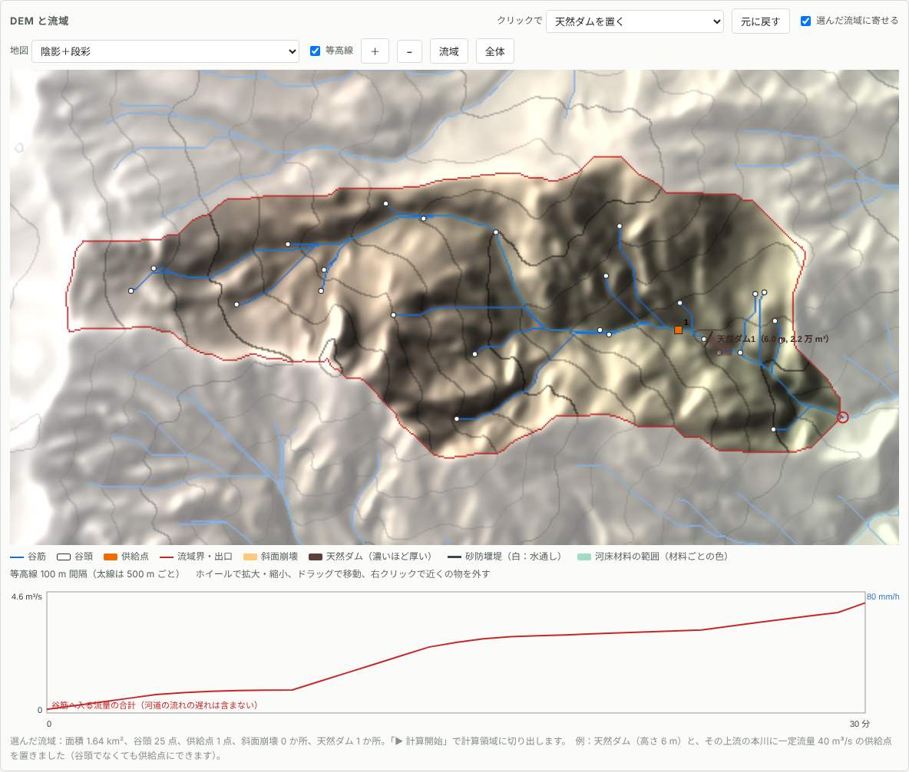
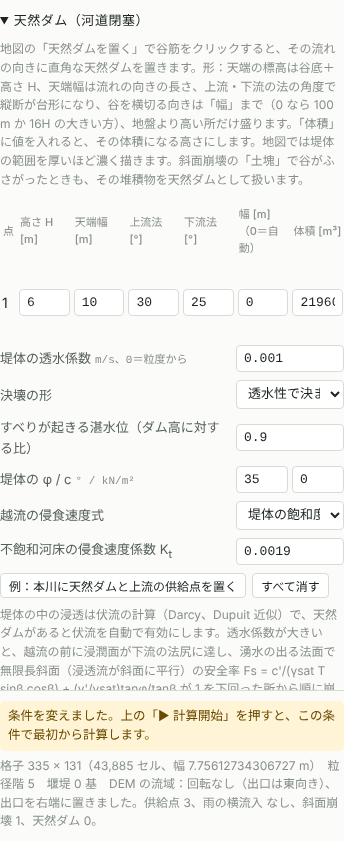

**形**：高さ H、天端幅、上流・下流の法の角度、谷を横切る幅（0 で自動）。**体積**を入れると、その体積になる高さにします。

**決壊の形**は堤体の透水係数で分かれます。

| 透水係数 | 決壊の形 |
|---|---|
| 小さい | 越流決壊：湛水が天端を越え、越流で侵食（不飽和の侵食速度式も選べる） |
| 大きい | 進行性崩壊：浸透で下流面が飽和し、安全率 < 1 の所から崩れていく |
| 「すべり」を選ぶ | 湛水位が設定の高さに達すると、下流のり先から上流の天端へすべる |

**計算例 1（越流決壊、透水係数 0）**

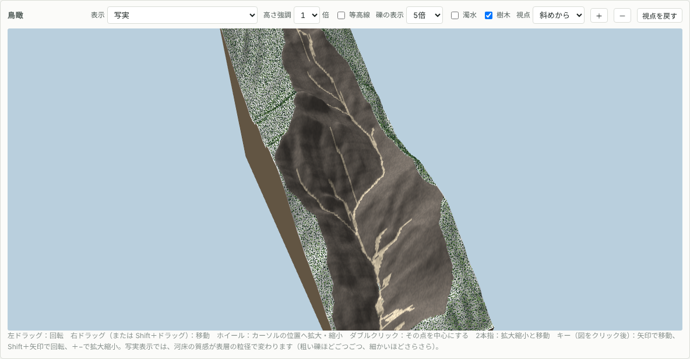
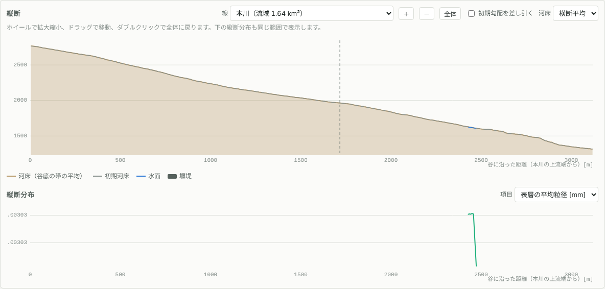
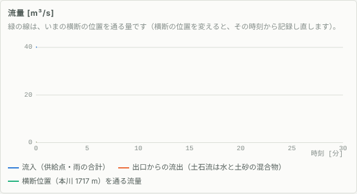

**計算例 2（進行性崩壊、透水係数 0.03 m/s）**


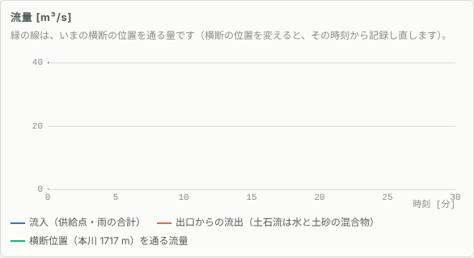

---

## 14. DEM の流域の砂防堰堤・河床材料

### 砂防堰堤

地図の「砂防堰堤を置く」で谷筋をクリックすると、流れの向き（前後 3 セルの谷筋から）に直角な堰堤を置きます。表で型・高さ・水通し幅・堤長（0 で袖が地盤に届く長さを自動）・開口を決めます。ここでは下流に不透過型、上流にスリット型を置きました。


堰堤ごとの堆砂量は、堰堤の上流面から上りに谷をたどった範囲で数えます。

### 河床材料の範囲

「④ 河床材料」タブで材料 B などを作り（[6 章](#6-粒径と河床材料場所ごとの粒度分布)）、地図の「河床材料の範囲を描く」で多角形を描きます。


---

## 15. Python 版

`python/sabo2d.py` はブラウザ版と同じ計算をする Python 版です（結果は丸め誤差の範囲で一致）。大きな格子や長い計算、まとめての計算に使えます。

```
pip install numpy matplotlib
python python/sabo2d.py --preset A --minutes 60 --out result            # 既定の河道
python python/sabo2d.py --debris --debris-peak 30 --out result_debris    # 土石流の一波
python python/sabo2d.py --params sabo2d_params.json                      # ブラウザ版で保存した条件をそのまま
python python/sabo2d.py --dem FG-GML-553706-DEM5A-20251113.zip --dem-outlet "X,Y" --dx 10 --debris \
    --rain "0:30,30:60,60:0" --dem-dam "X,Y,8" --slide-poly "X1,Y1;X2,Y2;X3,Y3@2,shallow,time,60,fluid"
```

DEM の座標（X, Y）は、DEM の座標系（基盤地図情報は経緯度を平面に直した m）です。ブラウザ版の DEM の欄の「計算条件を JSON で保存（Python 版用）」で保存し、`--params` で読むのが確実です。`python python/sabo2d.py --help` ですべてのオプションを表示します。Jupyter（Google Colab）用のノートブック `python/sabo2d.ipynb` もあります。

---

## 16. 扱わないこと・注意

- **浮遊砂・ウォッシュロード**は扱いません（掃流砂と土石流のみ）。
- **遮蔽効果**は、粒径別の限界掃流力（修正 Egiazaroff 式）だけで表します。露出した動かない礫による遮蔽や空隙率の変化（岩見・藤田 2023 など）は扱いません。
- 土石流では、代表粒径は流れている土砂の平均粒径で、土石流の中の粒径別の分級は扱いません。
- 斜面崩壊・天然ダム・雨の流出は、簡便なモデルです（式と仮定は [docs/model.md](../model.md)）。現地への適用では、パラメータを実測や既往事例で確かめてください。
- 疑似 XRAIN は架空の雨で、観測値ではありません。

---

画面の画像は `tools/manual_shots.js`（Playwright）で撮りました。`node tools/manual_shots.js dist/sabo2d.html <DEM の ZIP>` で撮り直せます。
